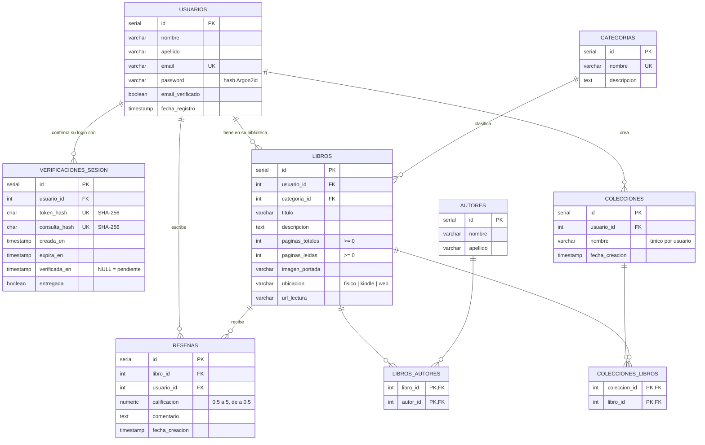

# Base de datos — Biblioteca Virtual

Motor: **PostgreSQL 18** en Docker (`database/docker-compose.yml`), con persistencia en el volumen `postgres_data`.
El esquema completo está en [`init.sql`](init.sql) y los cambios posteriores en [`migrations/`](migrations/).
Los ejemplos de gestión de datos están en [`crud.sql`](crud.sql).

---

## 1. Diagrama Entidad-Relación



**Cómo leer el diagrama:** `||--o{` significa "uno a muchos" (un registro del lado `||` se relaciona con cero o más del lado `o{`). Las relaciones muchos a muchos (N:M) se resuelven con las tablas intermedias `libros_autores` y `colecciones_libros`.

---

## 2. Tablas

| Tabla | Qué guarda | Tipo |
|---|---|---|
| `usuarios` | Cuentas: datos personales, email único y contraseña hasheada con Argon2id | Entidad |
| `verificaciones_sesion` | Cada inicio de sesión pendiente de confirmar por correo (solo hashes de los secretos) | Entidad dependiente |
| `categorias` | Catálogo compartido de géneros (General, Novela, Fantasía…) | Catálogo |
| `autores` | Catálogo compartido de autores | Catálogo |
| `libros` | Libros de la biblioteca de cada usuario, con su progreso de lectura | Entidad |
| `libros_autores` | Qué autores escribieron cada libro | Intermedia N:M |
| `resenas` | Calificación y comentario de un usuario sobre un libro | Entidad |
| `colecciones` | Agrupaciones de libros con nombre, propias de cada usuario | Entidad |
| `colecciones_libros` | Qué libros hay en cada colección | Intermedia N:M |

---

## 3. Relaciones entre tablas

| # | Relación | Cardinalidad | Clave foránea | Al borrar el "padre" |
|---|---|---|---|---|
| 1 | usuarios → verificaciones_sesion | 1 : N | `verificaciones_sesion.usuario_id` → `usuarios.id` | **CASCADE**: se borran sus verificaciones |
| 2 | usuarios → libros | 1 : N | `libros.usuario_id` → `usuarios.id` | **CASCADE**: se borra su biblioteca |
| 3 | categorias → libros | 1 : N | `libros.categoria_id` → `categorias.id` | **RESTRICT** (por defecto): no se puede borrar una categoría con libros |
| 4 | libros ↔ autores | N : M | `libros_autores.libro_id` → `libros.id`<br>`libros_autores.autor_id` → `autores.id` | **CASCADE** en ambos lados: se borra solo el vínculo |
| 5 | libros → resenas | 1 : N | `resenas.libro_id` → `libros.id` | **CASCADE**: se borran las reseñas del libro |
| 6 | usuarios → resenas | 1 : N | `resenas.usuario_id` → `usuarios.id` | **CASCADE**: se borran sus reseñas |
| 7 | usuarios → colecciones | 1 : N | `colecciones.usuario_id` → `usuarios.id` | **CASCADE**: se borran sus colecciones |
| 8 | colecciones ↔ libros | N : M | `colecciones_libros.coleccion_id` → `colecciones.id`<br>`colecciones_libros.libro_id` → `libros.id` | **CASCADE** en ambos lados: se borra solo el vínculo (el libro sigue en la biblioteca) |

### Por qué cada decisión

- **Cada libro pertenece a un usuario** (relación 2). Así cada persona tiene su propia biblioteca y el backend filtra siempre por `usuario_id`, de modo que nadie ve ni modifica libros ajenos.
- **Categorías y autores son catálogos compartidos.** No dependen de un usuario, porque "Borges" o "Fantasía" son los mismos para todos.
- **La categoría usa RESTRICT y no CASCADE** (relación 3). Si se borrara en cascada, eliminar una categoría haría desaparecer los libros de todos los usuarios. Por eso la base no deja borrarla mientras tenga libros, y además `categoria_id` tiene valor por defecto `1` (General).
- **Libros ↔ autores es N:M** (relación 4) porque un libro puede tener varios autores y un autor escribe varios libros. La clave primaria compuesta `(libro_id, autor_id)` impide cargar dos veces el mismo autor en un libro.
- **Colecciones ↔ libros es N:M** (relación 8) porque un libro puede estar en varias colecciones a la vez. Borrar una colección no borra los libros, solo el vínculo.
- **Todo lo del usuario se borra en cascada** (relaciones 1, 2, 6 y 7). Si se elimina una cuenta, no quedan libros, reseñas ni colecciones huérfanas.

---

## 4. Restricciones de integridad

| Tabla | Restricción | Regla |
|---|---|---|
| `usuarios` | `UNIQUE (email)` | No puede haber dos cuentas con el mismo email |
| `verificaciones_sesion` | `UNIQUE (token_hash)`, `UNIQUE (consulta_hash)` | Cada link de verificación es único |
| `categorias` | `UNIQUE (nombre)` | No se repiten categorías |
| `libros` | `check_ubicacion` | `ubicacion` ∈ {`fisico`, `kindle`, `web`} |
| `libros` | `check_paginas_totales`, `check_paginas_leidas` | Páginas ≥ 0 |
| `resenas` | `check_calificacion` | Entre 0.5 y 5, en pasos de 0.5 (medias estrellas) |
| `resenas` | `uq_resena_libro_usuario` | Un usuario reseña cada libro una sola vez |
| `colecciones` | `uq_coleccion_usuario_nombre` | Un usuario no repite nombres de colección (dos usuarios distintos sí pueden) |
| `libros_autores`, `colecciones_libros` | Clave primaria compuesta | Un vínculo no se duplica |

### Índices

Además de los que crea PostgreSQL para las claves primarias y los `UNIQUE`, hay índices en las columnas por las que más se busca:
`libros(usuario_id)`, `libros(categoria_id)`, `libros(titulo)`, `colecciones(usuario_id)` y `verificaciones_sesion(usuario_id)`.

---

## 5. Gestión de datos (CRUD)

El archivo [`crud.sql`](crud.sql) tiene ejemplos de **Create, Read, Update y Delete** para las 9 tablas, con las consultas con `JOIN` que usa la aplicación (biblioteca con progreso, libros con sus autores, reseñas con título y usuario, colecciones con cantidad de libros, promedio de calificaciones).

También incluye:

- **Pruebas de integridad:** intenta cargar datos inválidos (libro sin usuario, ubicación `tablet`, calificación 3.7, reseña duplicada, email repetido, borrar una categoría en uso) y muestra que la base los rechaza.
- **Borrado en cascada:** borra un libro y después el usuario, y comprueba que no quedan filas huérfanas.

Se ejecuta así, con la base levantada:

```bash
docker exec -i biblioteca_postgres psql -U biblioteca_user -d biblioteca_db < database/crud.sql
```

Todo corre dentro de una transacción que termina en `ROLLBACK`, así que **no modifica los datos reales**. Para guardar los cambios hay que reemplazar el `ROLLBACK` final por `COMMIT`.

### Resumen de operaciones por tabla

| Tabla | Create | Read | Update | Delete |
|---|---|---|---|---|
| `usuarios` | Registro | Buscar por email | Verificar email | Borrar cuenta (cascada) |
| `verificaciones_sesion` | Al iniciar sesión | Pendientes vigentes | Marcar verificada / entregada | Limpiar vencidas |
| `categorias` | Nueva categoría | Listar con cantidad de libros | Cambiar descripción | Solo si no tiene libros |
| `autores` | Nuevo autor | Listar por apellido | Corregir nombre | Borrar autor |
| `libros` | Agregar a la biblioteca | Biblioteca con % de progreso | Avance de lectura, ubicación | Borrar (cascada) |
| `libros_autores` | Asignar autor | Libro con sus autores | — (se borra y se vuelve a insertar) | Quitar autor |
| `resenas` | Calificar con medias estrellas | Reseñas con libro y usuario, promedio | Editar | Se borra con el libro o el usuario |
| `colecciones` | Crear | Listar con cantidad de libros | Renombrar | Borrar (los libros quedan) |
| `colecciones_libros` | Agregar libro | Libros de una colección | — | Sacar libro |

En la aplicación, este mismo CRUD lo ejecuta el backend Flask desde `app/services/` con consultas parametrizadas (`%s`) de psycopg2, lo que evita la inyección SQL.
